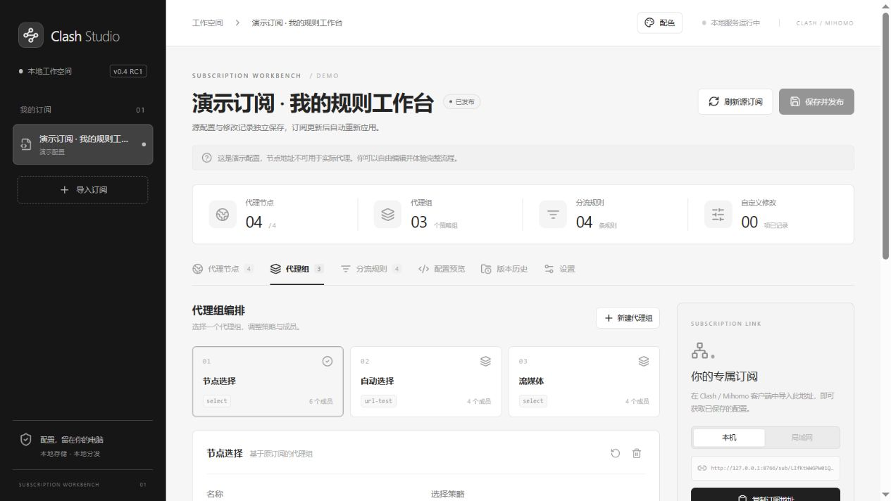
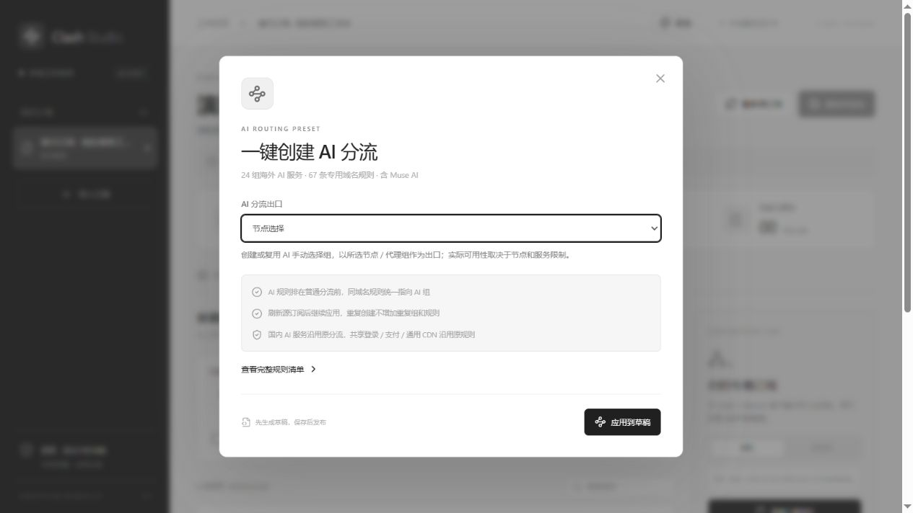
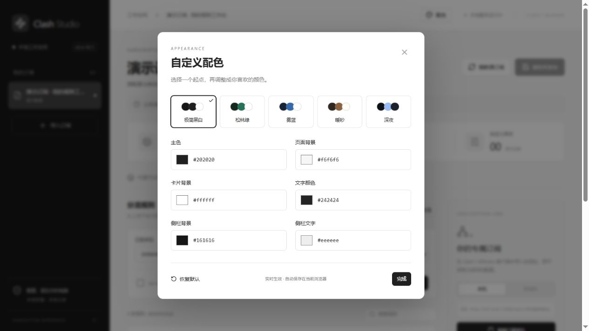

# Clash Studio · 本地订阅工作台

**简体中文** | [English](README.en.md)

一个运行在本机的 Clash / Mihomo 订阅可视化编辑与分发工具：把节点、代理组和分流规则放在同一张工作台上，刷新源订阅时重新应用自己的修改，再生成供本机或局域网设备使用的订阅地址。

**下一版：v0.4.1-rc.1 · 中英双语与跨平台原生包，等待候选包验收。**

[已发布版本](https://github.com/zheng0625/clash-subscription-studio/releases) · [源码仓库](https://github.com/zheng0625/clash-subscription-studio) · [原生包说明](docs/native-packages.md)

## 功能

- 从订阅 URL、YAML 文件或内置示例导入。
- 节点改名和排除，代理组策略与成员调整，规则添加、排序和搜索。
- 草稿预览与保存发布分离，源订阅更新后重新应用编辑记录。
- 历史版本恢复，独立随机令牌订阅地址，支持停用和重新生成。
- 一键创建 AI 分流：24 组服务、67 条域名规则，包含 Muse AI。
- 精确配置服务分流：为 Claude 等服务指定统一策略与出口，便于保持相关请求的出口一致。
- 可选局域网只读订阅共享，管理界面保持仅本机访问。
- 五套主题预设与六项自定义颜色，配色自动保存在当前浏览器。
- 中文 / English 界面，默认跟随浏览器语言，支持手动切换并记住选择。
- Windows、Linux 与 macOS 原生包：内置解释器、后端依赖和前端资源，解压后启动，无需额外安装 Python 或 Node.js。

## 项目特点与界面

### 可视化编辑，刷新后继续应用修改

通过界面调整节点名称、节点排除、代理组策略和组内成员，添加、搜索与排序分流规则。原始订阅与编辑记录分开保存，源订阅刷新后重新应用修改；遇到校验冲突时保留旧的已发布配置。草稿预览、保存发布和历史版本恢复让修改过程更清楚。



### 精确分流，让 Claude 等服务使用指定出口

适合希望为 Claude 等 AI 服务保持一致访问出口的使用者。内置预设使用精确域名与域名后缀规则匹配相关服务，为它们统一指定 AI 代理组；Claude / Anthropic 规则包含 `anthropic.com`、`claude.ai`、`claude.com` 和 `claudeusercontent.com`。预设规则优先于普通规则，同域名匹配统一指向 AI 组，以减少相关请求因规则遗漏或策略不一致而走向不同出口的情况。

如果希望尽量保持出口 IP 一致，建议为 AI 代理组选择一个稳定的指定节点，并检查客户端的实际规则命中。选择自动测速、故障转移或其他会切换节点的组，出口仍可能变化；固定节点的上游 IP 也可能发生变化。

本功能用于管理路由规则，不能保证完整覆盖服务未来使用的域名，也不能保证避免 Claude 等平台的异常 IP 判定、账号风控或封禁。实际结果还受节点 IP、客户端模式、DNS、地区及平台策略等因素影响。

### 一键创建 AI 分流

内置 **24 组海外 AI 服务、67 条专用域名规则，包含 Muse AI**。选择出口后先生成草稿，保存后才发布。刷新源订阅后继续应用，重复创建不增加重复组和规则；停用预设后恢复普通分流。国内 AI 服务以及共享登录、支付、通用 CDN 继续沿用原规则。



### 本地处理，支持局域网订阅

配置、编辑记录与历史版本保存在本机，无需将订阅提交给第三方订阅转换服务。生成的订阅地址供客户端读取已发布配置；可选局域网共享让同一网络的手机、电脑或路由器同步获取配置，管理界面保持仅本机访问。电脑和本软件需保持运行，局域网共享适用于可信私网。

### 简约界面，自定义配色

提供极简黑白、松林绿、雾蓝、暖砂和深夜五套预设；支持主色、页面背景、卡片背景、文字、侧栏背景和侧栏文字六项自定义颜色，实时预览并自动保存在当前浏览器。



以上截图均使用独立演示配置拍摄，不包含真实订阅或实际节点凭据。演示节点不可用于实际代理。

## 开发者与 AI 辅助开发说明

本项目由 **zheng0625 发起并主导，使用 OpenAI Codex 辅助开发**。从需求细化到代码实现、界面迭代、问题排查和发行准备，Codex 参与了多个开发环节，在此明确致谢。

| 参与者 | 主要贡献 |
| --- | --- |
| [zheng0625](https://github.com/zheng0625) · 项目发起者与维护者 | 提出需求、确定产品方向、提出功能与界面调整意见、完成实际使用测试和发布确认。 |
| OpenAI Codex · AI 开发助手 | 辅助架构设计与前后端代码实现、界面和配色调整、问题定位与修复、测试用例编写与开发阶段检查、文档整理和打包发布流程。 |

Codex 是辅助开发工具，项目维护与发布决策由维护者负责。AI 参与开发不代表代码没有缺陷；欢迎通过 Issue 和 Pull Request 提交问题与改进。

## 下载即用：原生包

选择与你的操作系统和处理器匹配的包，解压整个目录：

| 平台 | 启动方式 |
| --- | --- |
| Windows 10/11 x64 | 双击 `ClashStudio.exe` 或 `Start.cmd` |
| Linux x64 / ARM64 | 运行 `./Start.sh` |
| macOS Intel / Apple Silicon | 打开 `ClashStudio.app` 或 `Start.command` |

原生包包含 Python 运行时、所需后端依赖、已构建前端及完整项目源码，无需另外安装开发依赖，首次启动也无需下载依赖。需保留包内目录结构，并有可用的系统浏览器。启动后打开 `http://127.0.0.1:8765`；使用随包 Stop 入口停止服务。

界面右上角可以选择“自动语言 / 简体中文 / English”。自动模式随浏览器首选语言变化；手动设置保存在当前浏览器。切换语言不改写订阅节点名、代理组名称或 YAML。

macOS 包尚未提供开发者证书签名与 Apple 公证；Linux 需要兼容构建基线的 glibc 系统。各平台与数据迁移说明见 [原生包文档](docs/native-packages.md)。CI 构建产物是候选包，构建成功不等于所有实际设备已完成验收。

## 从源码运行（开发者）

1. 完整解压发行包到一个新目录。
2. 安装 Python 3.11 或更新版本，并确保能从命令行使用。
3. 双击 **启动软件.cmd**，等待依赖安装，然后打开 `http://127.0.0.1:8765`。
4. 首次使用可点“载入演示配置”。演示节点不能实际联网。

`*-source.zip` 是源码包，与原生包不同：不包含 Python 运行时，首次启动需要联网安装依赖。从 GitHub 源码启动还需要 Node.js 20.19+ / 22.12+ 和 npm 或 pnpm 来构建界面。Linux/macOS 的源码入口为 `bash start.sh` 和 `bash stop.sh`。已有的本地 Codex runtime 可被 Windows 启动脚本识别，但不是必需条件。

服务运行期间保持启动窗口打开。关闭服务请双击 **停止服务.cmd**，或在启动窗口按 Ctrl+C。局域网设备更新订阅时，电脑和本软件必须保持运行。

```powershell
.\start.ps1                  # 启动并打开浏览器
.\start.ps1 -Port 8877       # 使用其他管理端口
.\start.ps1 -Rebuild        # 重建前端
.\start.ps1 -NoBrowser      # 仅启动服务
.\stop.ps1                  # 停止服务
```

## 数据与局域网

源码模式默认将配置、编辑记录、历史、发布 YAML 和订阅令牌保存在当前软件目录的 `data/` 中；原生包使用系统用户数据目录，详见 [数据路径与迁移](docs/native-packages.md#用户数据)。局域网设置保存在数据目录的 `network.json`。不会自动上传到 GitHub。浏览器保存界面偏好、语言选择和上次选中的订阅 ID。

管理服务仅绑定回环地址，默认 `127.0.0.1:8765`。局域网共享默认关闭；在订阅“设置”中开启后，右侧选择“局域网”并复制地址到同一网络的设备。共享使用独立端口，默认 8767，只提供带令牌的订阅下载，不开放编辑界面。详见 [局域网共享说明](docs/lan-sharing.md)。

本机地址和局域网地址使用相同令牌与已发布配置。重置令牌或停用订阅会同时影响两种地址。请在可信网络传递链接，不做公网端口映射。必要时手动运行 **配置局域网防火墙.cmd**，其仅放行专用网络下本地子网的当前共享端口。

## 开发、测试与打包

技术栈：Vue 3 / TypeScript / Vite，FastAPI / SQLite / ruamel.yaml。

源码构建：在 `frontend/` 运行 `pnpm install --frozen-lockfile`、`pnpm build`，然后通过 Python 虚拟环境安装 `requirements.txt`，运行 `python run.py`。

- [贡献与开发说明](CONTRIBUTING.md)
- [架构与接口](docs/architecture.md)
- [AI 分流说明](docs/ai-routing.md)
- [验证范围](docs/verification.md)
- [发行前手动测试清单](docs/release-checklist.md)
- [安全与隐私](SECURITY.md)
- [更新记录](CHANGELOG.md)

`python scripts/package.py` 按白名单打包源码、文档、许可证和构建后的前端，并生成文件清单与 ZIP SHA-256 校验值。不会收录 `data/`、数据库、备份、截图、虚拟环境、node_modules 或 Git 历史。

## 范围

不提供代理节点或账号，不处理代理流量，不是 Clash/Mihomo 内核。基础结构和引用检查不能替代客户端内核兼容性验证。未实现所有协议参数、全部规则语义、外部 provider 展开、节点测速、多订阅聚合或系统安装器。原生包使用系统浏览器展示界面，自动刷新只在本服务运行时执行。

## 许可证

Copyright (C) 2026 zheng0625 and contributors.

本项目原始代码按 **GPL-3.0-only** 许可，完整条款见 [LICENSE](LICENSE)。对外分发修改版本时，请遵守 GPL 的源码提供等要求。本软件按原样提供，不提供担保。第三方依赖保留各自许可，随包声明见 [THIRD_PARTY_NOTICES.md](THIRD_PARTY_NOTICES.md)。
