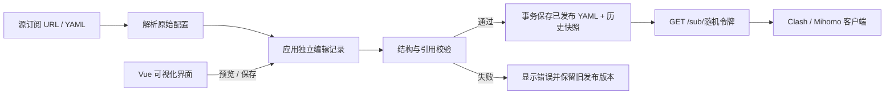

# 第一版架构与接口

## 核心流程



同一个进程提供构建后的前端、管理 API 和订阅输出。管理服务仅监听 `127.0.0.1`；启用局域网共享后，独立监听器仅提供只读订阅输出。订阅数据在 SQLite 中持久化，共享设置保存于 `data/network.json`，浏览器 localStorage 保存选中的订阅 ID 和地址显示模式。

## 编辑模型

```json
{
  "proxy_renames": {"香港 01": "香港主线"},
  "excluded_proxies": ["香港 02"],
  "group_overrides": {"节点选择": {"name": "主代理"}},
  "deleted_groups": [],
  "new_groups": [{"name": "AI 服务", "type": "select", "proxies": ["节点选择", "DIRECT"]}],
  "removed_rules": [],
  "added_rules": ["DOMAIN-SUFFIX,openai.com,AI 服务"],
  "rule_order": ["DOMAIN-SUFFIX,openai.com,AI 服务", "MATCH,节点选择"]
}
```

节点和原始代理组用原名引用，生成时一次性改写为输出名。对已有组仅保存发生变化的字段，保持其他字段随源订阅更新。新建组保存完整定义。规则按完整字符串识别；`rule_order` 只决定仍然存在的规则顺序，新上游规则随后插入兜底规则前。

刷新时先解析新源。合并有效则在一个 SQLite 事务中保存新源、已发布 YAML、编辑记录版本及历史快照；合并冲突则保留新源供修复、保留上一次已发布 YAML，并记录错误。网络失败或解析失败则不替换源。订阅 HTTP 请求只读 `published`，不触发上游下载。

SQLite 使用 WAL、外键、短事务和 20 秒忙等待。每次修改都要求 `revision` 相符，通过 `UPDATE ... WHERE revision=?` 防止旧页面或并发刷新覆盖新状态；不符返回 409。刷新产生冲突也会增加版本号。历史最多保留 50 条完整快照。

## API

管理写操作要求请求头 `X-Clash-Studio: 1`，浏览器 Origin 必须来自本地工作台。无跨站 CORS 授权。管理 API 供本机受信任用户使用，当前未设计远程登录能力。

| 方法 | 路径 | 作用 |
| --- | --- | --- |
| GET | `/api/health` | 服务状态 |
| GET / PUT | `/api/network` | 本机管理局域网共享状态、IPv4 地址与独立订阅端口 |
| GET | `/api/presets/ai` | 内置 AI 服务清单与精确/后缀规则 |
| POST | `/api/subscriptions/{id}/ai-preset` | 根据当前草稿与所选出口生成 AI 预设草稿，不保存发布 |
| GET / POST | `/api/subscriptions` | 列表 / 导入 |
| GET | `/api/subscriptions/{id}` | 源配置、编辑、校验和订阅路径 |
| PATCH | `/api/subscriptions/{id}` | 标题、启用状态、刷新周期 |
| DELETE | `/api/subscriptions/{id}?revision=N` | 删除订阅及历史 |
| POST | `/api/subscriptions/{id}/preview` | 预览未保存编辑 |
| PUT | `/api/subscriptions/{id}/edits` | 校验并发布编辑 |
| POST | `/api/subscriptions/{id}/refresh` | 拉取上游或替换文件源 |
| POST | `/api/subscriptions/{id}/rotate-token` | 更换订阅令牌 |
| GET | `/api/subscriptions/{id}/history` | 历史摘要 |
| GET | `/api/subscriptions/{id}/history/{version}` | 历史 YAML |
| POST | `/api/subscriptions/{id}/history/{version}/restore` | 恢复快照并创建新版本 |
| GET / HEAD | `/sub/{token}` | 获取最后成功发布的 YAML / 响应头 |

导入请求：

```json
{"title":"我的订阅","source_type":"url","source_url":"https://example.com/sub?token=..."}
```

文件导入：`source_type` 为 `file`，使用 `yaml` 字符串字段。演示导入使用 `source_type: "demo"`。

预览和保存：`{"revision":1,"edits":{...}}`。

AI 草稿接口：`{"revision":1,"edits":{...},"outlet":"日本 01"}`。返回 `edits`、`preview`、`catalogue_version`。编辑模型新增可选 `ai_routing: {"group":"🤖 AI 服务","enabled":true}`；`enabled:false` 停用预设并记住代理组，兼容旧版缺少此字段的编辑记录。生成时将清单规则放在普通规则前，覆盖同域名及其更窄域名的旧匹配，不删除原始规则。已有 AI 组可复用；循环出口会被拒绝。停用后恢复原始/手动规则，保留 AI 代理组，重新启用时复用该组（包括已重命名的组）。

刷新：URL 来源使用 `{"revision":1}`；文件来源使用 `{"revision":1,"yaml":"新版 YAML 文本"}`。成功下载但合并冲突返回 200 和含错误的订阅详情，`last_error` 与 `preview.errors` 说明冲突；下载或解析失败返回 400，客户端需要重新读取详情以获得新版本。

其他版本保护写操作使用 `{"revision":1}`。PATCH 额外要求 `title`、`enabled`、`interval_minutes`。禁用自动刷新使用 0，其他值表示分钟。所有时间以带 UTC 时区的 ISO 字符串存储，界面使用浏览器本地时区显示。

## 基础校验

- YAML 重复键、根类型、节点/代理组结构、危险标签、别名循环及展开限制。
- 节点/代理组名称重复、空名称、内置名称占用。
- 代理组成员和 provider 引用、空组、测试 URL、检测间隔、组间循环。
- 节点 dialer-proxy 引用；生成时同步改写节点、组、provider 的相关策略名称。
- 规则的基本分隔格式、策略目标、RULE-SET provider、SUB-RULE 目标。
- MATCH/FINAL 后续规则提示。

这不是完整 Mihomo schema。未验证所有协议参数、复杂规则语义、外部 provider 内容与内核支持情况，未执行测速和代理连通性检查。

## 后续扩展

建议依次增加内核配置检查、完整规则编辑器、provider 节点展开与过滤、DNS 可视化编辑、多订阅聚合，最后再考虑桌面 EXE。v0.3.0 已加入独立局域网只读分发：管理端保持回环绑定，LAN 端只注册令牌订阅路由，限制私网来源和本机 Host，关闭对转发头的信任。局域网设置保存在数据目录 network.json；启动成功后才提交配置，端口冲突保留旧监听器；主服务器统一管理 LAN 子服务器的生命周期与进程信号。
